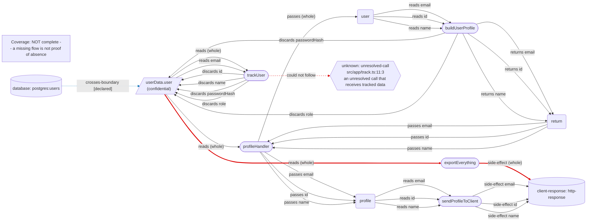

# Data flow

Coverage: 5 function(s) analyzed, 1 unknown(s) -- not complete: parts of the program could not be followed, so a flow missing below is not proof that it does not exist.

## Status legend

- **declared**: Asserted by an author in documentData(); not checked against code.
- **static**: Established by the analyzed code under the analysis's stated assumptions.
- **observed**: Witnessed in a specific execution or test.
- **inferred**: Plausible but not established: data assumed to pass through code the analysis could not follow.
- **unknown**: Not analyzable: dynamic behavior, missing source, an unsupported construct, or incomplete coverage.

## Functions

### exportEverything

- Confidence: static
- Classifications: confidential
- Inputs: res
- Reads: userData.user: (whole)
- Returns: none
- Passes on: none
- Side effects: client-response http-response: userData.user: (whole)
- Discards: none
- Callers: none
- Callees: none

### buildUserProfile

- Confidence: static
- Classifications: confidential
- Inputs: user
- Reads: userData.user (via parameter): email, id, name
- Returns: userData.user: email, id, name
- Passes on: none
- Side effects: none
- Discards: userData.user: passwordHash, role
- Callers: profileHandler
- Callees: none

### profileHandler

- Confidence: static
- Classifications: confidential
- Inputs: res
- Reads: userData.user: (whole); userData.user (via return): email, id, name
- Returns: none
- Passes on: buildUserProfile.user -- userData.user: (whole); sendProfileToClient.profile -- userData.user: email, id, name
- Side effects: none
- Discards: none
- Callers: none
- Callees: buildUserProfile, sendProfileToClient

### sendProfileToClient

- Confidence: static
- Classifications: confidential
- Inputs: profile, res
- Reads: userData.user (via parameter): email, id, name
- Returns: none
- Passes on: none
- Side effects: client-response http-response: userData.user: email, id, name
- Discards: none
- Callers: profileHandler
- Callees: none

### trackUser

- Confidence: inferred
- Classifications: confidential
- Inputs: none
- Reads: userData.user: (whole), email
- Returns: none
- Passes on: none
- Side effects: none
- Discards: userData.user: id, name, passwordHash, role
- Callers: none
- Callees: none
- Not followed: src/app/track.ts:11:3 -- an unresolved call that receives tracked data

## Fields

### userData.user

- Classification: confidential
- Fetched from: postgres:users (database, declared)
- Reaches: client-response http-response: (whole), email, id, name (static)
- Dropped by: buildUserProfile: passwordHash, role; trackUser: id, name, passwordHash, role
- Read by: exportEverything, profileHandler, trackUser
- Complete: no -- the analysis could not follow part of this field's flow, so the destinations above may be incomplete.

## Claims

- [verified] userData.user reaches client-response http-response (static)
- [unobserved] userData.user is sourced from database postgres:users (declared)
- [contradicted] Rule userData/no-password-to-client holds for userData.user (static)
- [verified] Rule userData/no-role-to-log holds for userData.user (static)

## What the analysis could not follow

- src/app/track.ts:11:3 -- an unresolved call that receives tracked data (call target is not a project function)

## Diagram

